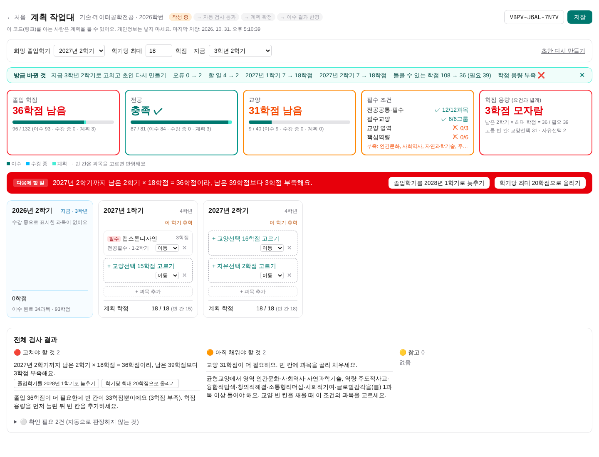

## 한 줄 소개

**부경대 공대생이 들은 과목을 체크하면 졸업까지 남은 요건을 진단하고, 학기별 수강 계획 초안을 만들어 주는 이수학점 관리 웹서비스.**

## 누가 쓰나

**국립부경대학교 공과대학 학생**이 쓴다.

### 페르소나 1. 교양 조건이 헷갈리는 1학년

| 항목 | 내용 |
|---|---|
| 이름 | 박OO / 1학년 / 시스템경영·안전공학부 (2026학번) |
| 상황 | 1학년 동안 관심 가는 교양만 들었는데, "교양은 영역·역량별로 다 채워야 한다"는 말을 듣고 불안해졌다 |
| 목표 | 지금까지 들은 교양으로 어떤 영역·역량이 비었는지 확인하고, 듣고 싶은 교양으로 그 빈칸을 채우고 싶다 |
| 불편 | LMS 강의계획서 조회에서 과목마다 하나씩 검색해 영역과 역량을 확인해야 한다. 빈 영역·역량은 직접 세야 하고, 다음 학기 교양 후보를 고를 때도 같은 일을 반복한다 |
| 제약 | 머리 아프게 과목을 일일이 다 찾아보기가 귀찮다 |

### 페르소나 2. 수강신청 실패로 계획이 틀어진 3학년

| 항목 | 내용 |
|---|---|
| 이름 | 한OO / 3학년 / 산업경영공학전공 (2024학번) |
| 상황 | 3학년 1학기에 듣기로 한 전공필수 수강신청에 실패했다. 이 과목이 다음 학기에도 열리는지, 남은 계획을 어떻게 바꿔야 할지 모르겠다 |
| 목표 | 못 들은 과목을 어느 학기로 옮길지 정하고, 그 때문에 다른 학기 학점이 넘치지 않는지 확인하고 싶다 |
| 불편 | 노션으로 짜 둔 4년 계획을 처음부터 다시 고쳐야 한다. 한 과목을 옮기면 그 학기 학점과 졸업요건을 전부 다시 계산해야 한다 |
| 제약 | 수강 정정 기간이 며칠뿐이라 빨리 결정해야 한다. 학기마다 이런 일이 반복된다 |

### 지금은 이렇게 하고 있다

| 지금 방법 | 불편한 점 |
|---|---|
| 학과 홈페이지에서 교육과정 PDF 직접 확인 | 학년·학기 권장만 있고 내 상황(휴학, 이수 과목)은 반영 안 됨 |
| 학사 시스템 졸업 자가진단 | 부족한 학점은 보이지만 **언제 무엇을 들을지**는 알려 주지 않음 |
| LMS 강의계획서 조회로 교양 영역·역량 확인 | 과목마다 하나씩 열어 봐야 하고, 빠진 영역·역량은 직접 세야 함 |
| 노션으로 직접 계획 | 한 과목을 옮기면 다른 학기 학점, 졸업요건을 손으로 다시 계산해야 함 |

## 데이터를 어떻게 확보했나

이 서비스는 학교 교육과정과 졸업요건 데이터가 있어야 돌아가기 때문에 공식 PDF 자료를 직접 엑셀로 옮겨 정리했다.

| 정리한 데이터 | 규모 | 출처 |
|---|---|---|
| 전공과목 (이수구분, 권장 학년·학기, 학점) | 공과대학 23개 전공, 967과목 | 「2026학년도 교육과정 안내서」 공과대학 학과별 교육과정 (89~133쪽) |
| 교양과목 (필수교양 그룹, 영역, 핵심역량, 학점) | 341과목 (필수교양 15, 균형교양 326) | 「2026학년도 교육과정 안내서」 교양교육과정 (16~19쪽) |
| 교양 이수 기준 (필수교양 9학점, 영역·역량별 1과목 이상, 최소 40학점) | 규칙 | 「2026학년도 교육과정 안내서」 (16쪽) |
| 전공별 졸업요건 (졸업·교양·전공·심화·자유선택 학점) | 23개 전공, 입학연도별 | 「2026 졸업 안내」 붙임2 입학연도별 졸업소요학점 |
| 전공필수 적용 기준 (이수학년도 기준) | 규칙 | 「2026 졸업 안내」 전공 이수 (2쪽) |
| 학과별 교육과정표 (대조용) | 산업경영공학, 기술·데이터공학 | 학과 홈페이지 교육과정 PDF |

※ 모든 자료는 국립부경대학교가 공개한 2026학년도 기준 자료다.

### 정리하면서 확인한 것

- **합계 검증**: 전공별로 정리한 학점을 이수구분별로 더해, 안내서 표의 소계(예: 전공공통 9 · 전공필수 27 · 전공선택 72학점)와 모두 일치하는지 확인했다.
- **자료끼리 대조**: 학과 홈페이지 PDF와 안내서를 비교해 보니, 4학년 과목의 학기 표기(1학기 / 1·2학기)가 서로 다른 경우가 있었다. 이런 부분은 서비스에서 "확인 필요"로 안내한다.
- **없는 데이터**: 공식 선수과목 조건은 자료에 없어서 검사하지 않는다. 교육과정표의 학기는 **실제 개설을 보장하지 않으므로** 참고용으로만 쓴다.
- **학번 차이**: 「2026 졸업 안내」를 보면 우리 학부는 2022~2026학번의 졸업학점 기준이 같다. 또 전공필수는 입학년도가 아니라 **그 학년을 다니는 해의 교육과정**을 따르기 때문에, 앞으로의 계획은 최신(2026) 교육과정을 기준으로 세운다.

## 무엇을 만드나

핵심은 **데이터를 보여 주는 사이트가 아니라, 계획을 세우고 고치는 과정을 처리해 주는 사이트**다.

```
기본정보 입력 → 이수 과목 체크 → 졸업요건 진단 → 초안 자동 생성 → 수정 → 재검사 → 저장
```

- **초안**: 꼭 들어야 하는 과목(전공필수, 필수교양)은 실제 과목으로 넣고, 선택과목은 필요한 학점만큼 **빈 칸**으로 남겨 직접 고르게 한다.
- **수정과 재검사**: 과목을 다른 학기로 옮기거나, 휴학을 넣거나, 졸업학기를 바꾸면 학기별 학점·졸업요건·오류가 즉시 다시 계산된다.
- **고치는 방법 제안**: "2028년 1학기가 21학점으로 3학점 초과" 같은 오류에 "이 과목을 2028년 2학기로 옮기기" 버튼을 붙인다.
- **저장**: 로그인 없이 12자리 코드와 링크로 저장하고 다시 불러온다.


*현재 만들고 있는 계획 작업대 화면 (개발 중)*

## 이번 학기에 어디까지 할 것인가

| 우선순위 | 기능 | 목표 |
|---|---|---|
| **Must** | 공과대학 23개 전공 지원, 이수 과목 입력, 졸업요건 진단, 초안 생성, 과목 이동·빈 칸 채우기, 재검사, 저장·불러오기 | 11/16 첫 배포 |
| **Should** | 계획 확정 기록, 실제 이수 결과 반영 후 남은 계획 갱신, 계획 비교 | 12/7 최종 |
| **Could** | 목록에 없는 과목 입력, 관심 교양 추천 개선 | 시간 남으면 |
| **Won't** | 과거 학번 교육과정, 공과대학 외 단과대학, 복수전공·부전공, 실제 시간표 충돌 검사, 로그인 | 이번 학기 안 함 |

비기능 요구사항은 숫자로 정했다.

- 과목을 옮기면 **1초 안에** 진단과 오류가 다시 계산된다.
- 이수 과목 입력은 3학년 기준 **5분 안에** 끝난다 (학년·학기별 "전체 이수" 버튼).
- 결과는 참고용이며 **"졸업 가능"이라고 판정하지 않는다.** 자동으로 확인할 수 없는 조건(공학인증, 실제 개설 여부)은 "확인 필요"로 따로 보여 준다.

## 주제를 정하면서 AI에게 시킨 것

주제는 AI(ChatGPT, Claude)와 같이 찾았지만, 결국 **AI가 낸 목록에서 고른 게 아니라 버리면서 좁혀 갔다.**

1. **"대학생이 불편해하는 걸로 10개"** → 과제 마감 모음판, 물품 대여 장부 같은 기록·조회 서비스가 나왔다. 캘린더나 노션으로 충분해서 버렸다.
2. **"교수님이 복잡했으면 좋겠다고 하셨다"** → 근무 배정 최적화, 상자 포장 조합 같은 알고리즘 주제가 나왔다. 복잡하긴 한데 **쓸 사람이 떠오르지 않았다.**
3. **공강 장소 추천**으로 정하고 블로그 초안까지 썼다가, AI에게 "정말 적합한지 판단해 봐"라고 했더니 "노트북으로 할 일이 아니고 금방 안 쓰게 된다"는 약점이 나왔다. 그래서 내가 원래 고민하던 **수강 계획**으로 바꿨다.
4. 교수님이 **"데이터가 생명인 것보다 프로세스가 생명"**이라고 하셔서, 졸업요건 조회가 아니라 계획 → 수정 → 재검사 흐름을 중심으로 다시 설계했다.

AI가 틀렸거나 내가 고친 부분도 있었다.

- AI는 처음에 **선택과목까지 자동으로 채운 계획**을 만들었다. 학생이 고를 부분까지 AI가 정하는 건 맞지 않아서 **빈 칸**으로 바꾸게 했다.
- AI는 과거 학번에 2026 교육과정을 적용하면 안 된다고 했지만, 이번 학기 범위에서는 **2026 기준을 쓰되 화면에 그 가정을 항상 표시**하기로 내가 정했다.
- 처음 만든 화면은 학년을 입학년도로만 계산해서 **93학점을 들은 학생이 1학년으로** 나왔다. 휴학 입력과 학년 확인 기능을 추가했다.

🟨 *(AI 대화 캡처 2~3장 넣을 자리)*

## 다음 할 일

- [ ] 친구 3명 실제 인터뷰 (1학년 1명, 3~4학년 2명)
- [ ] 2편: 교육과정 데이터와 계획 저장 테이블 ERD
- [ ] 3편: 첫 배포 (11/16)
