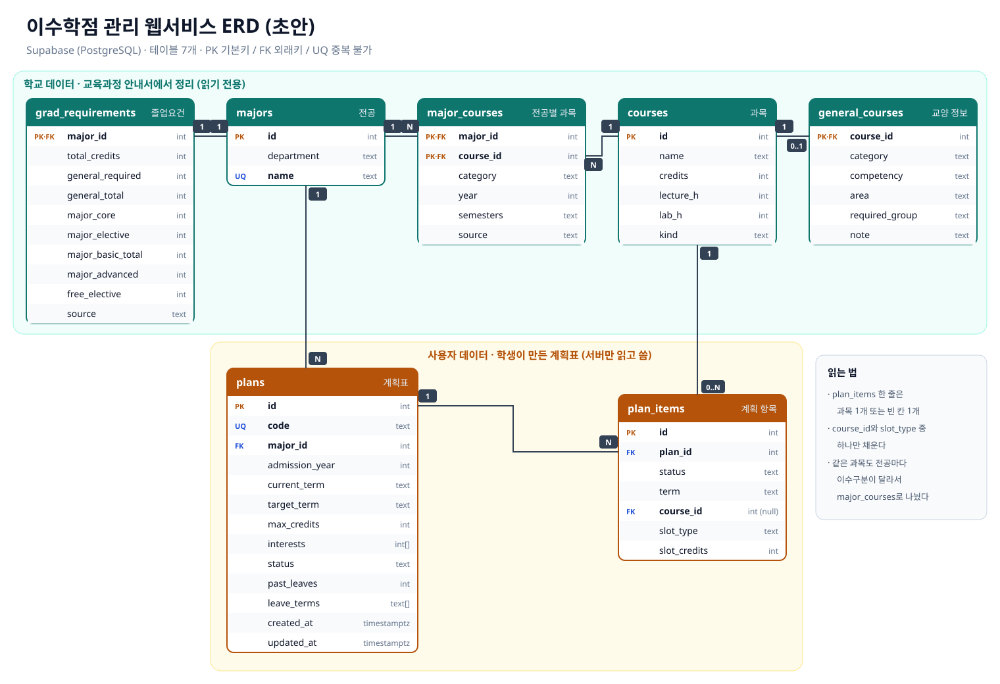

## 1. 무엇을 저장해야 하나

이 서비스가 저장하는 데이터는 두 종류다.

| 구분 | 내용 | 특징 |
|---|---|---|
| **학교 데이터** | 전공, 졸업요건, 과목, 전공별 과목, 교양 정보 | 교육과정 안내서에서 정리한다. 학기 중에 바뀌지 않고, 누구나 읽기만 한다 |
| **사용자 데이터** | 학생이 만든 계획표와 계획표 안의 과목 | 학생마다 다르고 계속 바뀐다. 서버만 읽고 쓴다 |

데이터베이스는 **Supabase(PostgreSQL)**를 쓰고, 테이블은 7개다.

---

## 2. ERD

🔍 <a href="/assets/img/2026-11-09-erd.svg" target="_blank" rel="noopener">ERD 크게 보기 (새 창)</a> · 상자 안에서 위아래·좌우로 스크롤해서 볼 수 있다.

---

## 3. 테이블

| 테이블 | 저장하는 것 | 주요 칸 |
|---|---|---|
| `majors` | 전공 | 학부, 전공 이름 |
| `grad_requirements` | 전공별 졸업요건 | 졸업학점, 교양 학점, 일반전공 학점, 심화전공 학점, 자유선택 학점 |
| `courses` | 과목 하나 | 과목명, 학점, 강의·실습 시간, 전공 과목인지 교양 과목인지 |
| `major_courses` | 전공과 과목의 연결 | 이수구분(전공공통·전공필수·전공선택), 권장 학년, 학기 |
| `general_courses` | 교양 과목의 추가 정보 | 필수교양·균형교양, 영역, 핵심역량, 필수교양 택1 그룹 |
| `plans` | 학생의 계획표 하나 | 불러오기 코드, 전공, 입학년도, 지금 학기, 희망 졸업학기, 학기당 최대 학점, 휴학 정보, 상태 |
| `plan_items` | 계획표 안의 한 줄 | 이수 완료 / 수강 중 / 계획, 학기, 과목 또는 빈 칸 |

---

## 4. 관계

1. **전공 1 : 졸업요건 1**: 전공마다 졸업요건이 하나씩 있다.
2. **전공 N : 과목 N**: 한 전공에 과목이 여러 개 있고, 한 과목이 여러 전공에 편성된다. 그래서 `major_courses`로 연결한다.
3. **과목 1 : 교양 정보 0..1**: 교양 과목만 영역과 핵심역량 정보를 가진다.
4. **전공 1 : 계획표 N**: 계획표는 전공 하나를 기준으로 만든다.
5. **계획표 1 : 계획 항목 N**: 계획표 하나에 과목과 빈 칸이 여러 줄 들어간다.
6. **과목 1 : 계획 항목 0..N**: 계획 항목이 빈 칸이면 과목이 없다.

---

## 5. 이렇게 나눈 이유

- **같은 과목도 전공마다 이수구분이 다르다.** 예를 들어 데이터베이스응용은 기술·데이터공학전공에서는 전공필수, 산업경영공학전공에서는 전공선택이다. 그래서 이수구분을 `courses`에 넣지 않고 `major_courses`에 넣었다.
- **교양 과목은 필요한 칸이 다르다.** 영역, 핵심역량, 필수교양 택1 그룹은 교양에만 있어서 `general_courses`로 따로 뺐다.
- **필수교양은 여러 과목 중 하나만 들으면 된다.** 예를 들어 글로벌외국어는 6과목 중 1과목이다. 같은 그룹인지 알 수 있게 `required_group`에 그룹 이름을 넣었다.
- **선수과목 테이블은 만들지 않았다.** 교육과정 안내서에 선수과목 조건이 없어서다. 학기는 `semesters`에 교육과정표 기준으로 넣었고, 실제 개설을 보장하지는 않는다.
- **선택과목은 빈 칸으로 저장한다.** 계획 초안에서 전공선택·교양선택은 과목을 정하지 않고 필요한 학점만 남긴다. 그래서 `plan_items` 한 줄에는 `course_id`(과목) 또는 `slot_type`·`slot_credits`(빈 칸) 중 **하나만** 채우도록 제약을 걸었다.
- **개인정보는 저장하지 않는다.** 이름이나 학번 칸이 없다. 계획표는 추측하기 어려운 12자리 코드로 다시 불러온다.

---

## 6. AI에게 시킨 것과 고친 것

정리한 교육과정 데이터를 AI(Claude)에게 주고 스키마 초안을 만들게 한 뒤, 서비스를 만들면서 아래처럼 고쳤다.

1. **SQLite에서 Supabase(PostgreSQL)로 옮겼다.** 첫 초안은 내 컴퓨터에서만 도는 SQLite 파일이었다. 배포한 사이트에서 쓰려고 Supabase로 옮겼다.
2. **계획 저장 테이블을 다시 설계했다.** 첫 초안의 `plan_courses`는 과목마다 '신청', '실패', '재수강' 같은 상태를 두었는데, 실제 흐름에 맞게 `plans`(계획표)와 `plan_items`(계획 항목)로 나누고 상태는 이수 완료 / 수강 중 / 계획 세 가지로 줄였다.
3. **빈 칸을 저장할 수 있게 했다.** 처음에는 선택과목까지 자동으로 과목을 채웠다. 학생이 고를 부분은 비워 두기로 하면서 `slot_type`, `slot_credits` 칸을 추가했다.
4. **휴학 정보를 추가했다.** 처음에는 학년을 입학년도로만 계산해서, 93학점을 들은 학생이 1학년으로 나왔다. 그래서 `plans`에 지난 휴학 학기 수(`past_leaves`)와 휴학 예정 학기(`leave_terms`)를 추가했다. 편입처럼 학년이 입학년도보다 높은 경우도 있어서 `past_leaves`는 음수도 받는다.

데이터를 넣은 뒤에는 전공별로 이수구분 학점 합계를 SQL로 더해서, 안내서의 소계(전공공통 9 · 전공필수 27 · 전공선택 72학점 등)와 일치하는지 확인했다. 지금 데이터베이스에는 시스템경영·안전공학부 3개 전공이 들어 있고, 나머지 공과대학 전공도 같은 구조로 넣는다.
