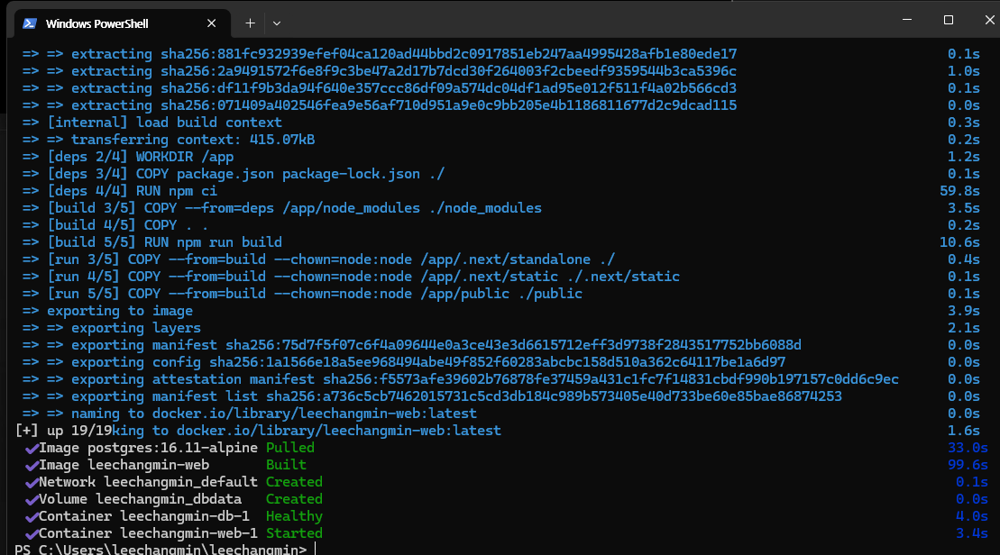
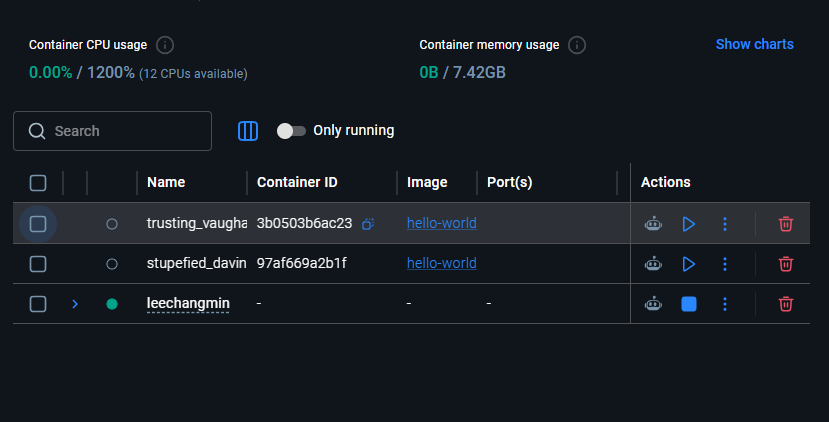
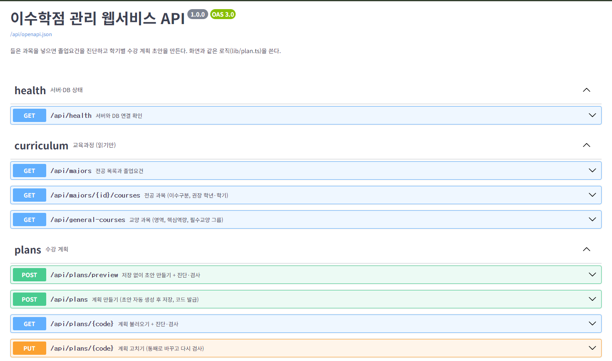
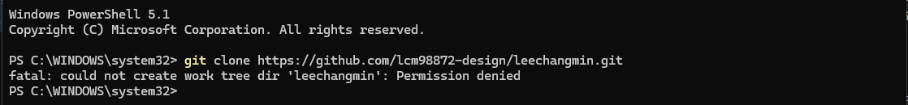
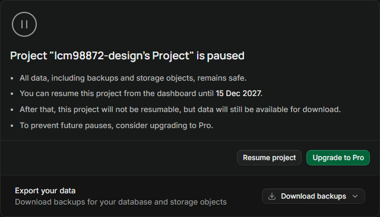

## 1. 구성을 이렇게 정했다

| 역할 | 선택 | 이유 |
|---|---|---|
| 웹 (화면 + 서버) | Next.js (TypeScript) | 화면과 서버를 한 프로젝트에서 만들 수 있다. 졸업요건 계산 로직을 화면과 서버가 같이 쓴다 |
| DB | PostgreSQL | 전공·과목·졸업요건처럼 서로 연결된 데이터라 관계형 DB가 맞다 |
| 실행 환경 | Docker, Docker Compose | 누구 컴퓨터에서든 같은 환경으로 실행된다 |
| 배포 | Vercel + Supabase(PostgreSQL) | 무료이고, GitHub `main`에 올리면 자동으로 배포된다 |
| 테스트 | Vitest | 졸업요건 계산 로직을 실제 교육과정 데이터로 검사한다 |

처음에는 Flask + Render도 후보였다. Render 무료 요금제는 한동안 안 쓰면 서버가 잠들고, 다시 열 때 1분 가까이 걸린다. 사용성 평가 때 첫 화면이 늦게 뜨면 안 돼서 제외했다.

---

## 2. Docker로 옮겼다

처음에는 Vercel과 Supabase에 바로 배포했다. 수업에서 Docker를 써야 해서, 강의 순서대로 옮겼다.

1. Dockerfile을 쓴다
2. 내 컴퓨터에서 컨테이너로 띄워 본다
3. 클라우드에 올린다

### 컨테이너 구성

| 컨테이너 | 하는 일 |
|---|---|
| `db` | PostgreSQL 16. 처음 뜰 때 테이블과 교육과정 데이터가 자동으로 들어간다 |
| `web` | Next.js. 화면과 API를 같이 맡는다 |

`docker compose up -d --build` 한 줄로 두 개가 같이 뜬다.

### 바꾼 것

1. **DB 연결 방식을 바꿨다.** 처음 코드는 Supabase 전용 방식(supabase-js)으로 DB에 접속해서, 그냥 PostgreSQL인 `db` 컨테이너에는 붙지 않았다. 그래서 PostgreSQL 주소 하나(`DATABASE_URL`)로 접속하도록 바꿨다. 이제 같은 코드가 로컬에서는 `db` 컨테이너에, 배포에서는 Supabase에 붙는다.
2. **비밀값은 이미지 밖에 두었다.** DB 주소에는 비밀번호가 들어 있다. 이미지나 GitHub에 넣지 않고, 실행할 때 환경 변수로 넣는다.
3. **데이터는 컨테이너 밖에 두었다.** DB 데이터는 볼륨에 저장해서 컨테이너를 지워도 남는다.
4. **이미지를 작게 만들었다.** 빌드 단계와 실행 단계를 나눠서 실행 이미지에는 결과물만 넣었다. 베이스 이미지는 버전을 고정했다(latest 안 씀).

---

## 3. 배포 결과

| 주소 | 내용 |
|---|---|
| [leechangmin-chi.vercel.app](https://leechangmin-chi.vercel.app) | 서비스 화면 |
| [leechangmin-chi.vercel.app/api/docs](https://leechangmin-chi.vercel.app/api/docs) | API 문서. 버튼을 눌러 직접 실행해 볼 수 있다 |

API는 9개다. 화면과 같은 계산 로직을 쓴다.

| 구분 | API |
|---|---|
| 상태 확인 | 서버와 DB 연결 확인 |
| 교육과정 (읽기만) | 전공 목록, 전공 과목, 교양 과목 |
| 계획 | 미리보기(저장 없이 초안과 검사), 만들기, 불러오기, 고치기, 지우기 |

---

## 4. 막혔던 점

1. **PowerShell에서 저장소를 받을 수 없었다.** `git clone`을 했더니 `Permission denied`가 나왔다. PowerShell이 윈도우 시스템 폴더(`C:\WINDOWS\system32`)에서 열려 있었기 때문이다. `cd ~`로 내 폴더로 옮긴 뒤 다시 받았다.

   

2. **Supabase 프로젝트가 멈춰 있었다.** 무료 요금제는 일주일 동안 안 쓰면 자동으로 멈춘다. 그동안은 배포 사이트도 DB에 붙지 못한다. Resume project로 다시 켰다. 사용성 평가 전날에 한 번씩 들어가서 확인하기로 했다.

   

3. **DB 비밀번호가 기억나지 않았다.** 새 연결 주소에 넣을 비밀번호를 몰라서 Database Settings에서 새로 만들었다. 특수문자가 있으면 주소가 깨질 수 있어서 영어와 숫자만 썼다.
4. **저장 테스트에서 오류를 찾았다.** DB 연결 방식을 바꾼 뒤, 듣고 싶은 교양을 골랐을 때만 저장이 실패했다. 과목 번호 목록을 숫자가 아니라 글자 목록으로 보내고 있었다. 숫자 목록으로 명시해서 고쳤다.

---

## 5. AI에게 시킨 것과 고친 것

1. **구성 선택**: 기획서와 코딩 경험을 알려 주고 구성을 추천받았다. Render의 잠드는 문제 때문에 Vercel로 정했다.
2. **Docker 파일 작성**: Dockerfile, compose 파일, DB 연결 코드를 AI가 만들었다. 강의 체크리스트(베이스 이미지 버전 고정, 비밀값이 파일에 없는지, 데이터가 컨테이너 밖에 있는지, 내 컴퓨터에서 브라우저로 열리는지)로 하나씩 확인했다.
3. **API 추가**: 교수님 예시처럼 API 문서 주소를 추가하게 했다. 만들기 → 불러오기 → 고치기 → 지우기 순서로 실제 DB에 호출해서 확인했다.
