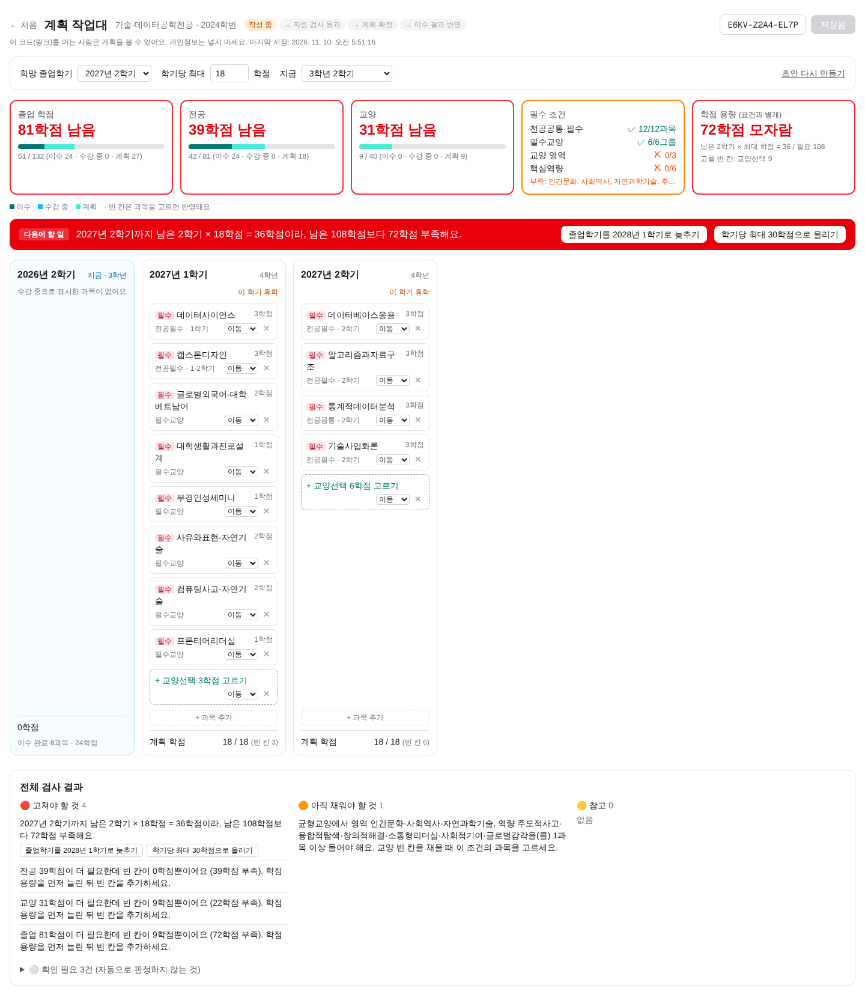
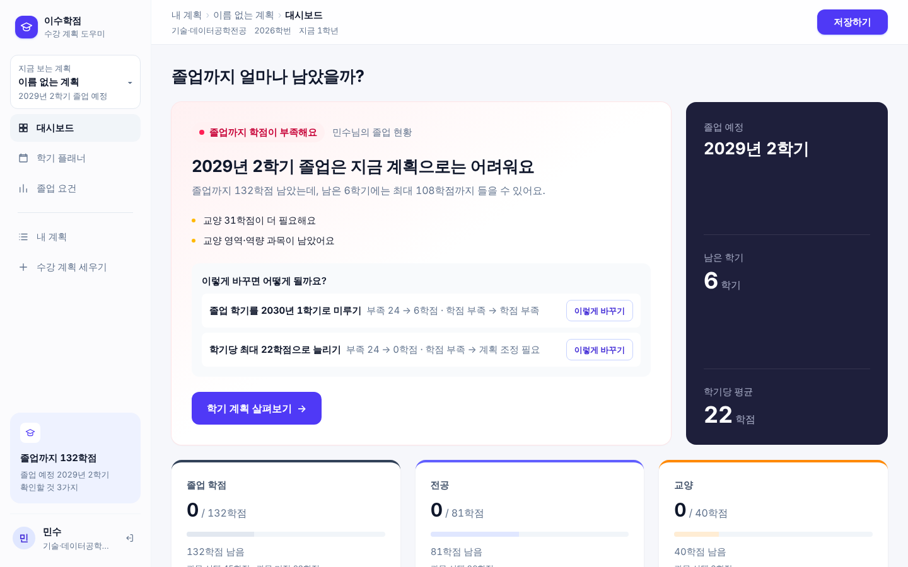
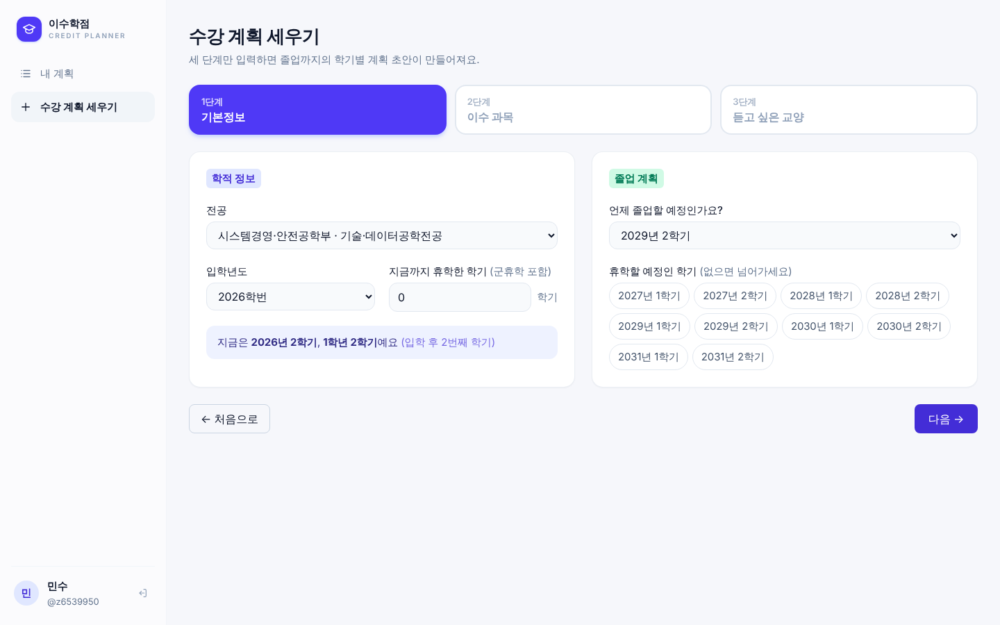
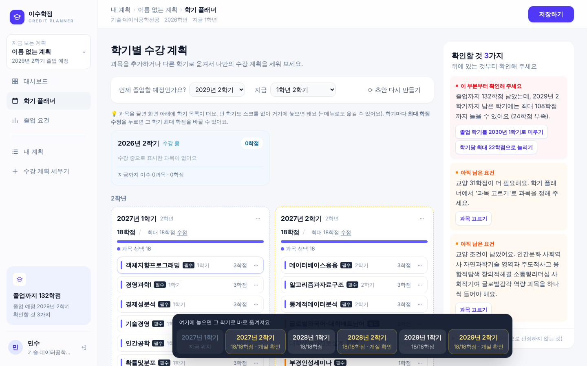
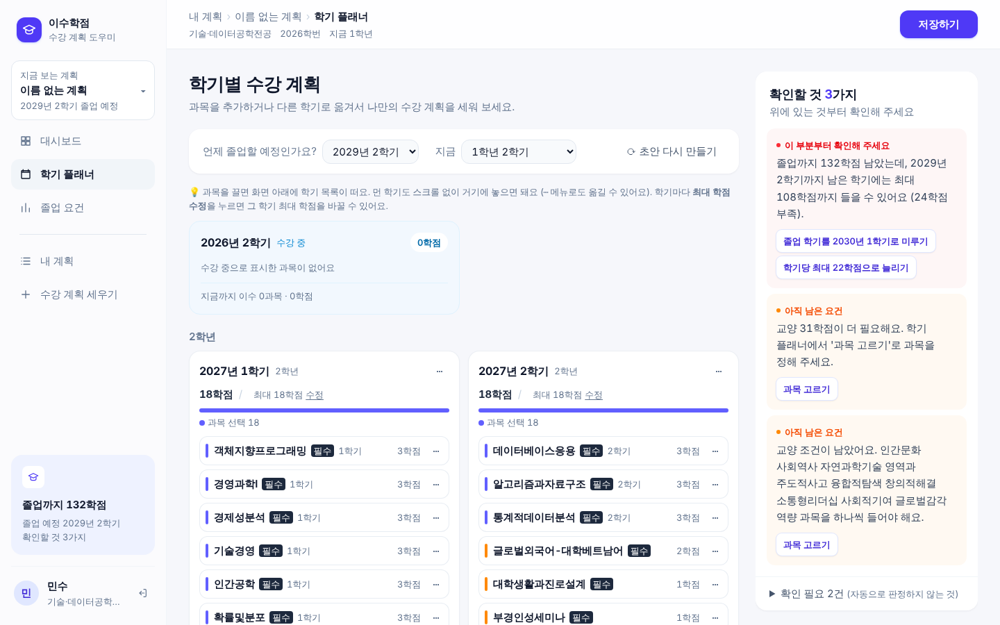
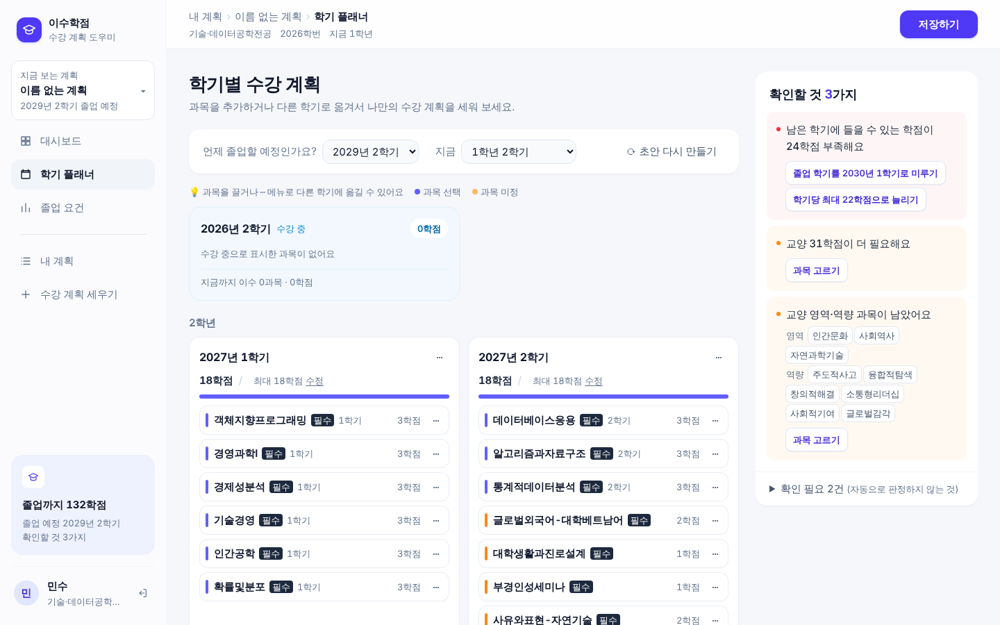
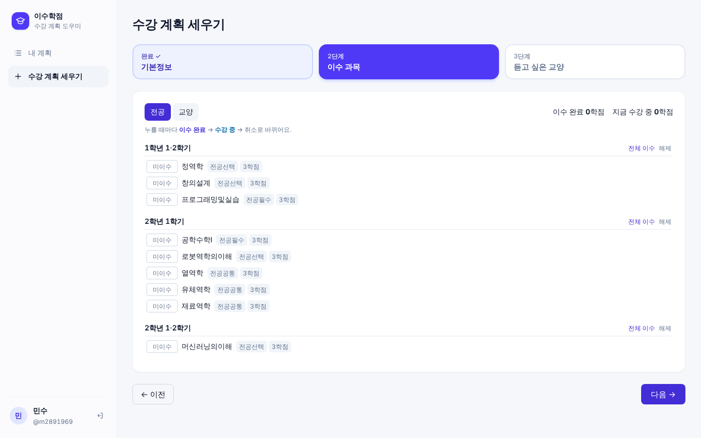
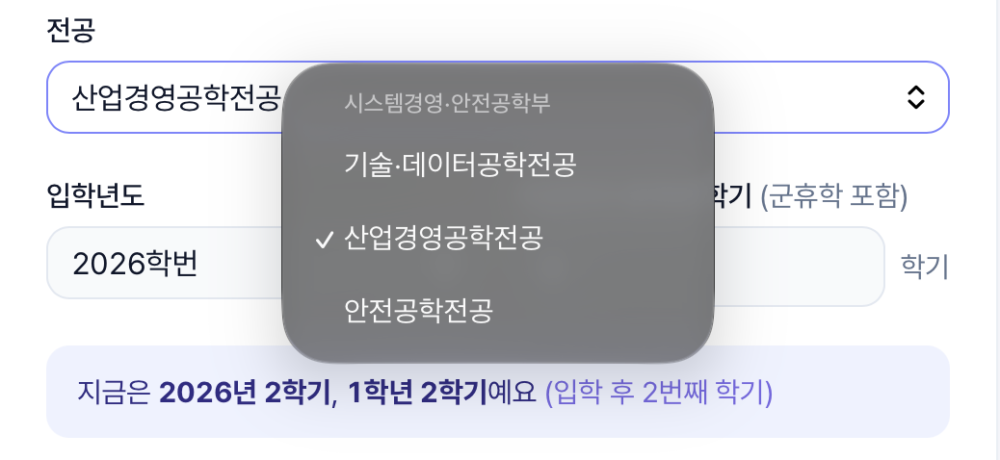
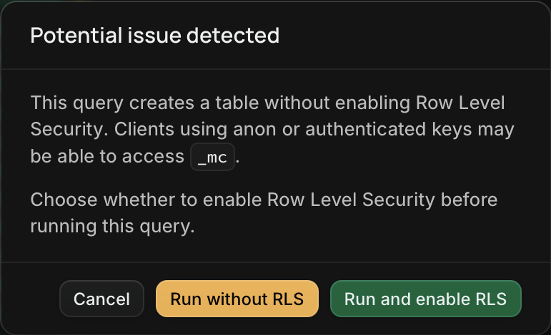

3편까지는 "첫 배포"였다. 그 뒤로 화면을 거의 새로 만들고, 로그인을 붙이고, 지원 전공을 3개에서 23개로 늘렸다. GitHub에 올린 PR 27개를 하나씩 다시 보면서 무엇을 왜 바꿨는지 카테고리별로 정리했다.

- 서비스: [leechangmin-chi.vercel.app](https://leechangmin-chi.vercel.app)
- 지금 지원 범위: 국립부경대학교 공과대학 23개 전공, 2026학년도 교육과정 기준

---

## 1. 한눈에 보기

| 카테고리 | PR | 한 줄 요약 |
|---|---|---|
| 기능의 바탕 | #1 ~ #7 | 교육과정 데이터, 초안 만들기, 졸업요건 검사, 휴학 |
| 배포와 자동 검사 | #8 ~ #11 | Docker, REST API와 API 문서, GitHub Actions, 페르소나 테스트 |
| 로그인과 내 계획 | #12 ~ #16 | 로그인 필수, 코드 없애기, 계획 이름과 목록 |
| 화면 다시 짜기 | #12 · #13, #17 ~ #19, #21 ~ #24 | 사이드바, 대시보드, 끌어서 옮기기, 넓은 화면 |
| 말과 글 | #20, #22, #25, #26 | 말투·용어, 글자 가독성, 글 줄이기 |
| 데이터 넓히기 | #27 | 공과대학 23개 전공 |

테스트는 24개 → 30개(#11) → 35개(#12) → 59개(#27)로 늘었다. PR을 올릴 때마다 GitHub Actions가 테스트, 코드 검사, 빌드, Docker 이미지 빌드를 자동으로 돌린다.

### 처음과 지금

처음 화면(3편 무렵)은 모든 정보를 한 화면에 쏟아 놓은 "계획 작업대"였다.

지금은 왼쪽 메뉴로 대시보드, 학기 플래너, 졸업 요건을 나눴다. 대시보드 맨 위에는 결론 한 문장만 둔다.

---

## 2. 기능의 바탕 (PR #1 ~ #7)

1·2·3편에서 자세히 다뤘으니 짧게 정리한다.

| PR | 한 일 |
|---|---|
| #1 · #2 | 교육과정 안내서를 CSV로 정리하고, Next.js 뼈대와 PostgreSQL 스키마를 만들었다 |
| #3 | DB 주소가 틀리면 페이지 전체가 죽던 문제. 원인을 화면에 보여 주게 했다 |
| #4 · #5 | 학기별 초안 만들기. 필수 과목은 실제 과목으로, 선택 학점은 "빈 칸"으로 넣고, 졸업요건을 4단계(오류 · 할 일 · 참고 · 확인 필요)로 검사한다 |
| #6 | 휴학. 지나간 휴학과 앞으로의 휴학을 따로 받고, 학기를 휴학으로 바꾸면 과목이 다음 학기로 밀린다 |
| #7 | 들은 학점에 비해 학년이 낮게 계산되면 알려 주고, 버튼 하나로 고친다 |

---

## 3. 배포와 자동 검사 (PR #8 ~ #11)

| PR | 한 일 | 왜 |
|---|---|---|
| #8 | Docker로 db + web 실행, 저장소 정리 | 수업의 Docker 강의 순서대로 옮겼다 (3편) |
| #9 | REST API 9개와 `/api/docs` | 교수님 예시처럼 화면과 같은 로직을 API로도 열었다 |
| #11 | GitHub Actions + 페르소나 시나리오 테스트 6개 | 강의의 "기획서의 예시가 테스트가 된다"를 그대로 따랐다 |

#11의 페르소나 테스트는 1편에서 만든 두 사람(1학년 박OO, 3학년 한OO)이 사용성 평가 과제를 하는 흐름을 그대로 코드로 옮긴 것이다. 예를 들어 "수강신청에 실패한 전공필수가 다음 1학기에 다시 들어가는가"를 매번 자동으로 확인한다.

---

## 4. 로그인과 내 계획 (PR #12 ~ #16)

처음에는 로그인 없이 **12자리 코드**로 계획을 저장했다. 코드를 아는 사람이면 누구나 열 수 있는 방식이었다. 써 보니 코드를 잃어버리면 끝이고, 내 계획이 어디 있는지 모아 볼 수도 없었다.

| 전 | 후 |
|---|---|
| 코드로 저장하고 코드로 불러오기 | 로그인하면 "내 계획" 목록에 모인다 |
| 코드를 아는 사람은 누구나 열 수 있음 | 만든 사람만 열고 저장할 수 있다. 다른 계정으로 주소를 열면 "찾을 수 없어요" |
| 계획에 이름이 없음 | 처음 저장할 때 이름을 묻는다 |
| 로그인하면 홈 화면 | 로그인하면 가장 최근 계획의 대시보드로 바로 간다 |

개인정보는 받지 않는다. 아이디, 비밀번호, 부를 이름만 받는다. 비밀번호는 해시로 저장하고, 로그인 쿠키에는 무작위 값만 넣고 DB에는 그 해시만 둔다.

#16에서는 "처음 계획 세우기"와 "졸업요건 점검하기"를 **"수강 계획 세우기"** 하나로 합쳤다. 두 기능이 결국 같은 일을 하고 있었다.

---

## 5. 화면 다시 짜기

### 5-1. 틀 바꾸기 (PR #12 · #13)

참고 화면을 보여 주고 같은 느낌으로 바꿨다.

- 왼쪽 사이드바, 아래쪽에 내 이름
- 밝은 화면만 쓴다. 컴퓨터가 다크 모드여도 검게 바뀌지 않는다
- 학기 플래너에서 과목을 **끌어서 다른 학기로 옮기기**
- 학기마다 최대 학점을 따로 정하기
- 교양이 한 학기에 몰리던 문제: 여러 학기에 고르게 나눈다

### 5-2. 대시보드와 메뉴 (PR #17 ~ #19)

Mobbin의 대시보드 사례, IBM Carbon의 대시보드 가이드, Linear의 리디자인 글, NN/g의 정보 구조(IA) 글을 읽고 적용했다.

- **대시보드 맨 위는 결론 한 문장 + 신호 색**: 초록(졸업 가능), 주황(채울 것 있음), 빨강(이대로는 어려움)
- **숫자는 3개만**: 졸업 학점, 전공, 교양. 들은 과목 목록은 접어 둔다
- **색은 뜻을 하나만**: 전체 = 회색, 전공 = 남색, 교양 = 주황. 빨강·초록은 상태에만 쓴다
- **지금 어디인지 보이게**: 사이드바 위에 "지금 보는 계획 ▾", 화면 위에 `내 계획 › 계획 이름 › 지금 화면`
- **메뉴 정리**: 계획 밖에서는 "내 계획 / 수강 계획 세우기"만 보인다. 어느 계획의 대시보드인지 알 수 없어서다

### 5-3. 고르기 쉽게, 결과가 보이게 (PR #21 · #22)

- 학기 카드의 막대를 **과목 선택(남색)**과 **과목 미정(주황)**으로 나눴다
- **"이렇게 바꾸면 어떻게 될까요?"**: 졸업 학기를 미루거나 최대 학점을 늘리면 부족 학점이 몇에서 몇으로 바뀌는지 미리 보여 준다
- 졸업 요건 화면에서 못 채운 조건을 누르면, 그 조건을 채울 수 있는 과목만 보여 준다
- 열리지 않을 수 있는 학기로 과목을 끌면 **막지 않고 안내만** 한다
- 드래그를 못 쓰는 사람을 위해 ⋯ 메뉴로도 옮길 수 있게 했다 (W3C 접근성 기준 2.5.7)

### 5-4. 빈 공간 줄이기와 끌어 놓기 (PR #23 · #24)

수강 계획 세우기 화면이 가운데에 좁게 모여 있어서 화면 너비를 다 쓰게 바꿨다.

학기 플래너에서 2학년 과목을 4학년으로 옮기려면 화면을 한참 내려야 했다. 드래그는 유지하고, **끄는 동안 화면 아래에 모든 학기 바로가기**를 띄웠다. 거기에 놓으면 스크롤 없이 옮겨진다. 화면 끝으로 가면 자동으로 스크롤도 된다.

---

## 6. 말과 글 (PR #20, #22, #25, #26)

### 6-1. 말투와 용어 (PR #20 · #22)

처음 문구는 "학점 용량", "빈 칸", "희망하는 마지막 학기"처럼 딱딱했다. 정확한 정보는 그대로 두고, 학생에게 자연스러운 말로 바꿨다.

| 전 | 후 |
|---|---|
| 희망 졸업학기 | 언제 졸업할 예정인가요? |
| 빈 칸 / 정할 과목 | 과목 미정 |
| 해야 할 일 | 확인할 것 N가지 |
| 학점 용량 | 남은 학기에 들을 수 있는 학점 |

균형교양, 핵심역량, 전공공통 같은 학교 공식 용어는 바꾸지 않았다. 학생이 학교 안내서에서 보는 말과 같아야 해서다.

### 6-2. 글자 (PR #25)

폰트를 바꿀지 여러 글을 찾아봤다. Pretendard, SUIT, Wanted Sans, Spoqa Han Sans Neo를 비교했고 **Pretendard를 그대로 쓰기로 했다**. 문제는 폰트가 아니라 규칙이었다.

- **한글이 단어 중간에서 끊겼다** ("학기 플래/너에서"). `word-break: keep-all`로 단어 단위로 줄을 바꾼다
- **연한 회색 글씨 32곳이 접근성 기준(4.5:1)에 못 미쳤다**. 한 단계 진하게 바꿨다
- **글자 크기가 제각각이었다** (10·11·13·15·26·28px). 토스 디자인 시스템을 참고해 13 / 15 / 17 / 18 / 22 / 26 / 30px만 쓰기로 했다
- **숫자 폭을 고정했다** (`tabular-nums`). "18/20학점" 같은 숫자의 줄이 맞는다

### 6-3. 글 줄이기 (PR #26)

NN/g 연구에 따르면 사람들은 한 페이지 글의 20% 정도만 읽는다. 토스 라이팅 원칙에도 "의미 없는 문장을 지워라"가 있다. 화면마다 글자 수를 세고 줄였다.

| 화면 | 전 | 후 |
|---|---|---|
| 홈 | 237자 | 86자 |
| 대시보드 | 489자 | 375자 |
| 학기 플래너 | 1135자 | 867자 |
| 졸업 요건 | 498자 | 427자 |

- 같은 긴 문장("졸업까지 132학점 남았는데…")이 세 화면에 반복되던 것을 대시보드에만 남겼다
- 교양 영역·역량 9개를 문장으로 늘어놓던 것을 칩으로 바꿨다
- 제목 아래에 붙어 있던 설명 문장을 지웠다

---

## 7. 데이터 넓히기: 3개 전공 → 23개 전공 (PR #27)

처음에는 우리 학부(시스템경영·안전공학부) 3개 전공만 손으로 정리했다. 다른 학과 친구도 쓸 수 있게 공과대학 전체로 넓혔다.

1. 학교 홈페이지에서 「2026학년도 교육과정 안내서」 PDF(882쪽)를 받았다
2. 공과대학 부분(88~134쪽)의 교육과정표를 프로그램으로 읽었다
3. 표 안의 **소계 66곳과 하나씩 대조**했다. 읽은 과목 학점의 합이 안내서의 소계와 모두 같았다
4. 손으로 정리했던 3개 전공 110과목과 비교했더니 **다른 곳이 0건**이었다
5. 23개 전공 모두 "막 입학한 학생의 초안에서 전공필수가 빠지지 않는가"를 테스트로 확인했다

결과: 전공 23개, 전공 과목 967개.

운영 DB(Supabase)에는 이미 저장된 계획이 있어서 지우고 다시 넣을 수 없었다. 그래서 **이미 있는 건 건너뛰고 새것만 넣는 SQL**을 만들었다. 두 번 실행해도 결과가 같고, 기존 과목 번호가 바뀌지 않아서 저장된 계획이 깨지지 않는다. "옛 DB + 이 SQL"과 "새로 만든 DB"의 결과가 같은지도 확인했다.

---

## 8. AI로 사용성 미리 점검하기

사람을 모아 평가하기 전에, AI에게 1편의 페르소나 역할을 주고 실제 사이트를 써 보게 했다. 사람 대신이 아니라 **사람 평가 전에 큰 문제를 미리 걸러 내는 용도**다.

AI가 찾은 불편 중 실제 버그였던 것 (#15에서 고침):

1. 학점이 넘친 학기를 고치라고 제안한 방법이, 다른 학기를 또 넘치게 만들었다
2. "1학기에만 열리는 과목을 2학기에 놓았다"는 경고가 접힌 곳에 숨어 있었다
3. 화면마다 "남은 학점"을 계산하는 기준이 달랐다

---

## 9. 막혔던 점

1. **PR이 두 번째 커밋 전에 합쳐졌다.** #12를 올리고 수정 커밋을 더 올리려는 사이에 #12가 먼저 머지됐다. 남은 커밋을 새 PR(#13)로 옮겼다. 그 뒤로는 커밋을 더 올리기 전에 PR이 이미 합쳐졌는지 먼저 확인한다.

2. **먼 학기로 끌어 놓기가 너무 불편했다.** 처음에는 드래그만 만들어 두고 끝냈는데, 학기가 8개면 화면을 계속 내려야 했다. 드래그를 없애지 않고 "끄는 동안 학기 바로가기"를 띄우는 방법으로 풀었다 (#24).

3. **PDF 표를 읽는 게 생각보다 어려웠다.** 처음에는 글자를 줄 단위로 읽었더니 66곳 중 27곳의 소계가 맞지 않았다. 원인은 이랬다.
   - 긴 과목명이 두 줄로 나뉘어 있었다 ("모형선제작의이해와 / 실습")
   - 과목명 뒤에 표시 기호가 붙어 있었다 (C = 교직, M = 해기사 면허, S = 사업 과목 등)
   - 학점이 두 줄로 쪼개진 칸이 있었다 ("15-0-" / "20")

   글자의 좌표로 표를 읽는 방식으로 바꾸고, 경우마다 규칙을 추가해서 66곳을 모두 맞췄다.

4. **Merge했는데 전공이 3개뿐이었다.** 코드는 배포됐는데 Supabase에 새 데이터를 넣는 SQL을 아직 안 돌린 상태였다. 학부별로 묶인 새 화면에 옛 데이터 3개만 보였다.

   

5. **GitHub 링크가 404였다.** SQL 파일을 복사하려고 링크를 열었더니 404가 떴다. 저장소를 비공개로 바꿨는데 아이패드 Safari에서는 GitHub에 로그인되어 있지 않았다. 파일을 따로 받아서 복사했다.

6. **Supabase가 보안 경고를 띄웠다.** SQL을 실행하려 하자 "RLS 없이 표를 만든다"는 경고가 나왔다. 경고에 나온 `_mc`는 SQL이 도는 동안만 쓰고 끝나면 사라지는 임시 표였다. 실제 데이터가 들어가는 표는 원래 읽기 전용으로 RLS가 켜져 있어서 "Run without RLS"로 실행했다.

   

---

## 10. AI에게 시킨 것과 내가 고친 것

AI는 빠르게 많이 바꿨지만, 방향은 내가 여러 번 바로잡았다.

| AI가 한 것 | 내가 고친 것 |
|---|---|
| 열리지 않는 학기로 과목을 끌면 놓지 못하게 막았다 | 막지 말고 안내만 하라고 했다. 학생이 일부러 그렇게 계획할 수도 있다 |
| 범례 색을 신호 색과 맞추려고 했다 | 과목 종류(전공·교양) 색과 상태(이수·계획) 색은 뜻이 달라서 그대로 두라고 했다 |
| 화면 문구를 "학점 용량", "정할 과목"처럼 딱딱하게 썼다 | 학생 말투 기준을 다시 정해 줬다. 플래너 설명은 내가 직접 "나만의 수강 계획을 세워 보세요"로 정했다 |
| UI를 고치자고 했는데 평가 계획·일정까지 넣었다 | 지금은 UI/UX만 고친다고 범위를 다시 정했다 |
| 폰트를 바꾸는 안 여러 개를 제안했다 | 비교 자료를 보고 Pretendard 유지, 규칙만 고치는 안을 골랐다 |
| 학기 플래너가 길고 빽빽한 걸 문제로 보지 못했다 | 스크린샷을 보여 주며 다시 고치게 했다 |

모든 변경은 PR로 올리고 내가 직접 Merge했다. DB를 바꾸는 PR은 "Supabase에서 SQL 먼저 실행 → Merge" 순서를 PR 설명에 적게 했다.

---

## 11. 회고

### 잘된 것

- **작게 나눠 올렸다.** PR 27개, 하나에 주제 하나. 문제가 생기면 그 PR만 되돌리면 된다
- **확인 수단이 있었다.** 테스트 59개와 GitHub Actions가 PR마다 돌아서, 화면을 크게 바꿔도 계산 로직이 깨지지 않았다
- **근거를 찾고 바꿨다.** NN/g, Carbon, W3C, 토스 글을 읽고 "왜 이렇게 바꾸는지"를 PR 설명에 남겼다
- **데이터를 대조했다.** 23개 전공으로 넓힐 때 안내서 소계와 하나하나 맞춰 봤다

### 아쉬운 것

- **실제 사람에게는 아직 못 써 보게 했다.** AI 사전 점검만 했다. 다른 공대 전공 친구에게 직접 써 보게 하는 게 다음 할 일이다
- **새로 넣은 20개 전공은 검증이 덜 됐다.** 교육과정표와 졸업 학점만 반영했다. 해기사 면허, 교직, 공학교육인증처럼 학과가 따로 정한 기준은 "확인 필요"로 안내만 한다
- **모바일 화면은 손대지 못했다**

### 다음 버전에 넣고 싶은 것

1. 실제 사용자 평가 후 고치기
2. 학번별 교육과정 (지금은 2026학년도 기준 하나)
3. 공학교육인증 이수 기준 반영
4. 모바일 화면
